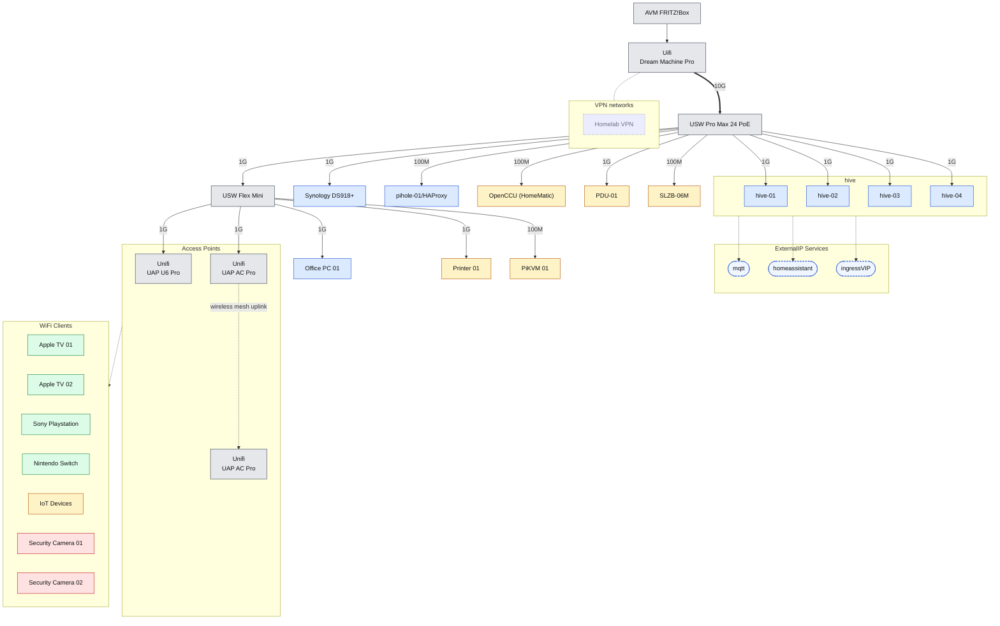

+++
draft = false
title = 'Projects'
ToC = true
showShare = false
showReadTime = false
showDate = false
comments = false
+++

## Homelab

My homelab is running on 4 Intel NUCs, all happily chugging along with k3s. The network backbone is a UniFi setup, featuring a UDMPro and a UniFi Switch 24 Pro POE. Right now, it’s a cozy 1GB network, but I’m planning to bump it up to 2.5GB soon—because, well, who doesn’t love faster speeds? The only thing slowing me down at the moment is the backup process—Longhorn and Kasten.io backups are giving me a bit of a bottleneck, with everything stored safely on my trusty old Synology DS918+.

A few details about what makes it all work smoothly:
* [Traefik](https://traefik.io/) (Dynamic ingress controller)
* [ArgoCD](https://argo-cd.readthedocs.io) (GitOps continuous delivery)
* [Kasten.io](https://www.veeam.com/products/cloud/kubernetes-data-protection.html) (Kubernetes backup solution)
* [Longhorn](https://longhorn.io/) (Cloud-native storage)
* [Bitnami Sealed Secrets](https://github.com/bitnami-labs/sealed-secrets) (Encrypted secrets management)
* [Graylog](https://graylog.org/) (Centralized log management)
* [RenovateBot](https://github.com/renovatebot/renovate) (Automated dependency updates)
* [MetalLB](https://metallb.io/) (Load balancing for bare-metal)
* [cert-manager](https://cert-manager.io/) (TLS certificate management)
* [kube-prometheus-stack](https://github.com/prometheus-community/helm-charts/tree/main/charts/kube-prometheus-stack) (Monitoring stack)
    * [Grafana](https://grafana.com/) (Data visualization)
    * [Prometheus](https://prometheus.io/) (Metrics collection)
    * [AlertManager](https://prometheus.io/docs/alerting/latest/alertmanager/) (Alert management)

... more details about the cluster and what Apps I am hosting, in my [homelab series](series/homelab)

## Home Assistant

[Home Assistant](https://www.home-assistant.io/) is like my home’s personal assistant, but instead of scheduling meetings, it’s reminding me to take the trash out and telling me when the washer’s done. It’s got some quirks, though—sometimes it seems to know me better than I know myself, like when it randomly turns on the lights at 3 AM and I’m left wondering if it’s just being helpful or trying to send me a message. At least it’s not sending passive-aggressive reminders… yet.

A few integrations I use:
* [Alarmo](https://github.com/nielsfaber/alarmo)
* [Google Calendar](https://www.home-assistant.io/integrations/google/)
* [Homematic(IP) Local](https://github.com/SukramJ/custom_homematic)
* [InfluxDB](https://www.home-assistant.io/integrations/influxdb/)
* [Nintendo Switch Parental Controls](https://github.com/pantherale0/ha-nintendoparentalcontrols)
* [ONVIF](https://home.gavriliu.com/config/integrations/integration/onvif)
* [OpenWeatherMap](https://www.home-assistant.io/integrations/openweathermap/)
* [OpenWeatherMap History](https://github.com/petergridge/openweathermaphistory)
* [SMLIGHT](https://www.home-assistant.io/integrations/smlight/)
* [Tasmota](https://www.home-assistant.io/integrations/tasmota/)
* [UniFi Network](https://www.home-assistant.io/integrations/unifi/)
* [UniFi Protect](https://www.home-assistant.io/integrations/unifiprotect/)
* [Waze Travel Time](https://www.home-assistant.io/integrations/waze_travel_time/)

<!-- ... and more on my [GitHub Repository](https://github.com/AndreiGavriliu/homelab/cluster/hive/apps/homeassistant/k8s-manifests) -->
... more details about my Home Assistant instance and what Integrations I am using, in my [homeassistant series](series/homeassistant)

## Tasmin

I’m building Tasmin — a GitOps-like manager for your Tasmota devices that not only updates, configures, and backs them up, but also checks for changes in the config and corrects them when the devices finally decide to show up on the network. Think of it like [TasmoAdmin](https://github.com/TasmoAdmin/TasmoAdmin) and [TasmoBackup](https://github.com/danmed/TasmoBackupV1), but with a ‘because I can’ attitude. Powered by [FastAPI](https://fastapi.tiangolo.com/) and a sprinkle of ‘I can do this better… probably’ energy!

I’m too ashamed of my code right now, so the repository will be posted at a later date… after I make it look like I know what I’m doing.